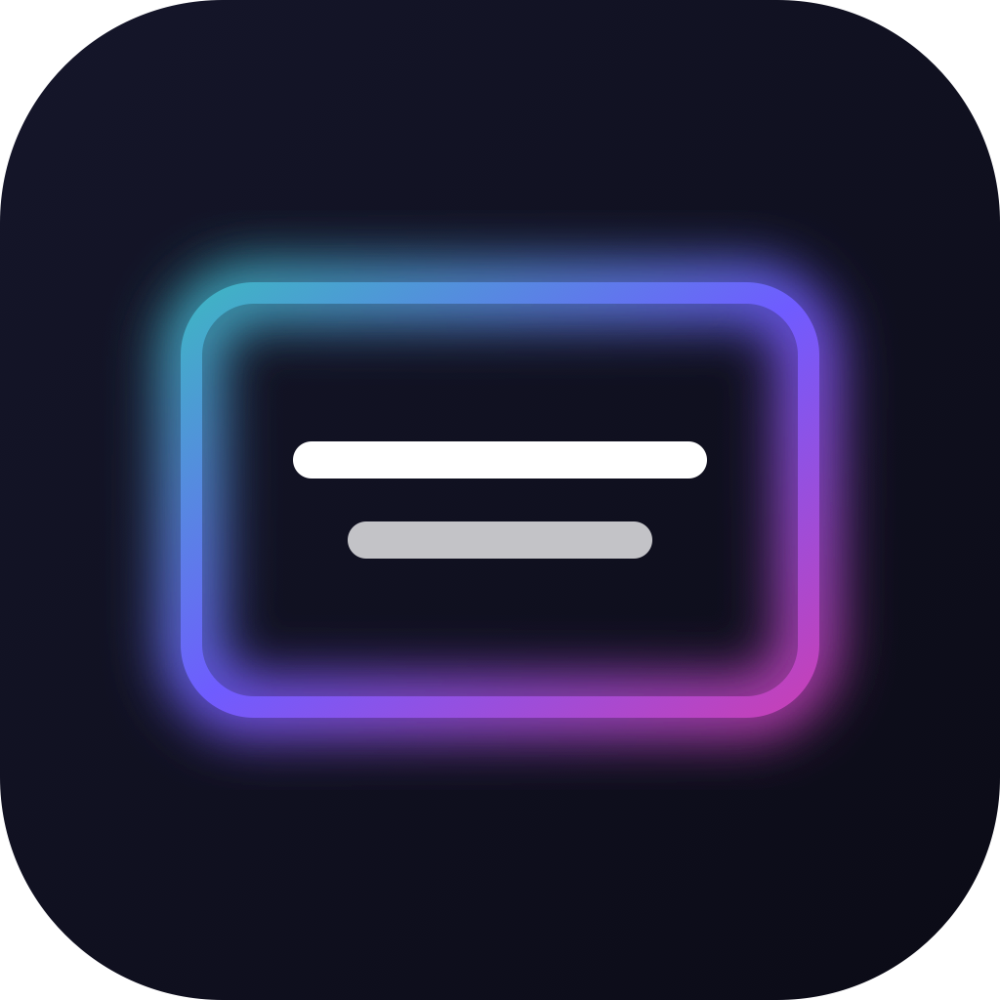

<p align="center">
  
</p>

<h1 align="center">Overlay Generator</h1>

<p align="center">
  Animated title overlays with transparent backgrounds, ready for <b>DaVinci Resolve</b>, <b>Premiere Pro</b> and <b>After Effects</b>.<br>
  Built by <b>The Goosebumps Company (G&amp;G)</b> so editors no longer have to wait on the design team for every title.
</p>

<p align="center">
  <a href="https://the-goosebumps-company.github.io/overlay-generator/"><b>Open the app</b></a> ·
  <a href="https://github.com/The-Goosebumps-Company/overlay-generator/releases/latest/download/Overlay-Generator-Mac.zip">Download for Mac</a> ·
  <a href="CHANGELOG.md">What's new</a> ·
  <a href="docs/DEVELOPMENT.md">Developer guide</a>
</p>

---

**Current version: 1.3.1.** See the [releases](https://github.com/The-Goosebumps-Company/overlay-generator/releases) and the [changelog](CHANGELOG.md).

Pick a template, type your text and export. You get a ProRes 4444 `.mov` with alpha that animates in, holds and animates out, ready to drop on a track above your footage. The design team sets up templates once, and editors make as many overlays as they need.

## Contents
- [For editors](#for-editors)
  - [Install](#install)
  - [Make an overlay](#make-an-overlay)
  - [Batch export from a list](#batch-export-from-a-list)
  - [Use it in your edit](#use-it-in-your-edit)
  - [Troubleshooting](#troubleshooting)
- [For the design team](#for-the-design-team)
- [For maintainers](#for-maintainers)
- [Licences](#licences)

---

## For editors

### Install

You only need a browser. There's nothing to sign or approve, and nobody's computer has to stay on.

| | How | Best for |
|---|---|---|
| **Web app** (recommended) | Open **https://the-goosebumps-company.github.io/overlay-generator/** in Chrome or Edge and click **Install app** in the top bar. In Safari: **File → Add to Dock**. | Everyone, on Mac or Windows. Works offline after the first visit and updates itself. |
| **Mac app** | Download **[Overlay-Generator-Mac.zip](https://github.com/The-Goosebumps-Company/overlay-generator/releases/latest/download/Overlay-Generator-Mac.zip)**, unzip it, open **Terminal**, type `bash ` (with a space), drag in **install.sh** and press **Enter**. | Macs that should run their own copy. If Homebrew ffmpeg is installed, exports are faster. |

The Mac installer needs no admin password and no Apple signing: it builds the app on your own Mac and puts **Overlay Generator** in Launchpad. Run it again to update; your own templates and fonts are kept. *HOW TO INSTALL.txt* in the zip has the details.

### Make an overlay

1. **Pick a template.** The G&G ones come first: *Pyro title*, *Frequency lower third* and *Schedule with time*.
2. **Type your text.** Each line in the box becomes a line on screen.
3. **Choose the output:**
   - **Shape:** Landscape (YouTube, TV, screens), Portrait (Reels, TikTok, Stories), Square (feed posts) or Feed 4:5 (Instagram portrait posts).
   - **Quality:** HD or 4K. *Custom size* is there if you need exact pixels.
   - **Frame rate:** match your edit. Not sure? Use 25 fps.
   - **Length:** how many seconds, including the in and out animations.
4. **Export overlay.** The file lands in your Downloads folder. You can cancel an export at any time.

Fine-tune anything you like: font, size, colours (the G&G swatches are one click away), the glow, moving light, a badge such as a time, the animation styles and the position. **Undo** (⌘Z), **Redo** (⇧⌘Z) and **Reset to template** are in the bar under the preview. Use **Save template** to keep a look for later.

Preview over a checkerboard, black, white, green or **your own footage** with the background picker under the preview.

### Batch export from a list

For speaker lower thirds, schedule cards or credits:

1. Set up the look once: template, font, animation and format.
2. Click **Batch export from a list…** and paste your list. Rows copied from **Google Sheets or Excel** work as-is.
   - Each **row** becomes one overlay.
   - Each **column** becomes a line on screen. You can also separate lines with `|`.
   - With the badge on, tick **First column is the badge** to give each overlay its own time or tag.
3. Click any row to preview it, then **Export**.

In **Chrome or Edge** you pick a folder once, and numbered files (`01_…`, `02_…`) are saved straight into it. Other browsers download the files one after another.

### Use it in your edit

| App | What to do |
|---|---|
| **DaVinci Resolve** | Put the `.mov` on a track above your footage (e.g. V2). It works as-is. |
| **Premiere Pro** | Put it on a track above your footage. Transparency is detected automatically. |
| **After Effects** | Import it. If asked, interpret the alpha as *Premultiplied – matted with black*. |
| **PNG sequence** | Unzip it and import the first frame as an image sequence. Works in any app. |

**Formats**

| Format | When to use it |
|---|---|
| **ProRes 4444 + alpha (.mov)** | Default. Smooth playback in Resolve, Premiere and After Effects. |
| QuickTime Animation (.mov) | Lossless, the same codec as the design team's renders. Very large files. |
| PNG sequence (.zip) | Any other app, or when you need individual frames. |

`.mov` files use premultiplied alpha, the same as After Effects renders, so they look right everywhere, even in players that ignore transparency.

### Troubleshooting

| Problem | Fix |
|---|---|
| The app shows **Checking…** and no templates | Close it and open it again, or press ⌘⇧R. This only affects copies installed before v1.3.1; newer versions fix themselves. |
| The glow has a hard edge or a solid colour band | Export again with v1.2.1 or later. Older exports used straight alpha. |
| Exports are slow | Without a server, exports run in your browser: about 50 s for a 5-second 1080p overlay. The Mac app with Homebrew ffmpeg, or an office server, takes a few seconds. |
| Something else | In the web app, open the browser console (⌥⌘J) and look for lines starting with `[overlay]`. In the Mac app, send `~/Library/Application Support/Overlay Generator/logs/app.log`. |

---

## For the design team

- **Templates:** design a look in the app and click **Save template**.
  - In the **web app** it's saved in that browser.
  - To give it to **everyone**, click **Download design file** in the top bar, put the `.json` in [`presets/`](presets/) and push to `main`. It appears as a *Team* template for everyone after the next deploy, about a minute.
- **Brand fonts:** anyone can click **Add** next to the font picker to use a font file. To ship a font to everyone, put it in [`fonts/`](fonts/) and push.
  > ⚠️ This repository is **public**. Only commit fonts whose licence allows public distribution. Bricolage Grotesque, the G&G typeface, already loads from Google Fonts.
- **Brand:** the app follows the G&G Brand Guideline: Backline Blue `#071A26`, Pyro Amber `#FB690C`, Crimson Surge `#790000`, Aqua Beam `#044E61`, Bricolage Grotesque, and the Pyro and Frequency gradients. The built-in G&G templates are in [`public/presets.js`](public/presets.js).

---

## For maintainers

The app is plain HTML, CSS and JavaScript with **no npm dependencies**. Every push to `main` deploys to GitHub Pages automatically.

```bash
npm start          # run locally at http://localhost:4321 (office-server mode)
npm run build      # build dist/web (website) and the Mac zip
```

To publish a release with a new Mac zip:

```bash
npm run build && cp "dist/Overlay Generator (Mac).zip" dist/Overlay-Generator-Mac.zip
gh release create vX.Y.Z dist/Overlay-Generator-Mac.zip --title "Overlay Generator X.Y.Z" --notes "…"
```

Read the **[developer guide](docs/DEVELOPMENT.md)** for the architecture, how exports work, the office-server option, logging and the release checklist.

---

## Licences

The in-browser video encoder in `public/vendor/ffmpeg` is [ffmpeg.wasm](https://github.com/ffmpegwasm/ffmpeg.wasm). The wrapper is MIT licensed and the ffmpeg core build is GPL. That's fine for internal use; check with legal before selling or distributing the app outside the company.

The G&G name, logo and brand assets are © The Goosebumps Company.
